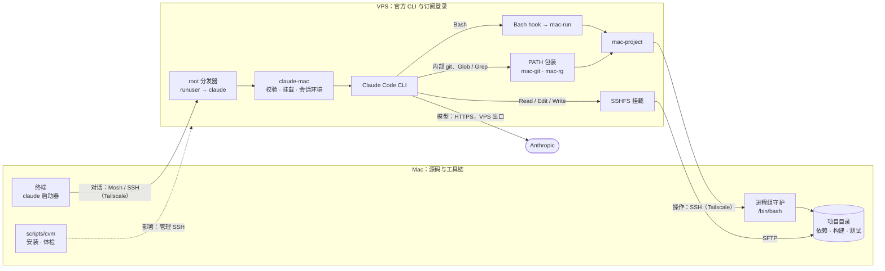

<h1 align="center">claude-vps-mac</h1>

<p align="center">官方 Claude Code 运行在 VPS 上，源码、依赖、构建和测试留在 Mac。</p>

在 Mac 的项目目录输入 `claude`，对话的是 VPS 上以普通用户运行的官方 CLI。订阅登录和模型请求使用 VPS 的网络出口；Bash 命令、git、搜索和文件读写都落在 Mac 的同一个项目目录上。项目只在 Mac 保留一份，不做同步副本。

这是一次个人部署整理出的经验项目，包含实际使用的脚本、配置模板、部署步骤、测量数据和取舍。

## 架构



### 四条通道

| 通道 | 路径 | 承载 |
| --- | --- | --- |
| 对话 | Mac 终端 → Mosh（默认）或 SSH，经 Tailscale → VPS | 按键和终端画面 |
| 操作 | VPS → SSH，经 Tailscale、固定主机密钥 → Mac | 命令通道承载 Bash、CLI 内部 git、Glob/Grep；SFTP 挂载承载文件读写 |
| 模型 | VPS 上的 CLI → HTTPS → Anthropic | 订阅登录与模型请求，使用 VPS 原有出口 |
| 部署 | Mac 仓库 → 管理 SSH（root）→ VPS | `cvm` 安装与体检，不参与日常对话 |

Tailscale 只连通两端私网，不设出口节点、不接管 DNS。Mosh 只监听 VPS 的 Tailscale 地址。

### 每种工具在哪里执行

| 调用 | 执行位置 | 机制 | 实测 |
| --- | --- | --- | --- |
| Bash（默认） | Mac 的 `/bin/bash`，独立进程组 | PreToolUse hook → mac-run → mac-project | 约 0.5 s/次 |
| Bash 首行或末行末尾带 `#vps`、单独 `cd` | VPS | hook 放行 | — |
| Read / Edit / Write / NotebookEdit | VPS 进程读写 Mac 文件 | SSHFS 实时挂载，不缓存内容，同步写入 | 读写链路：Read 约 3 s，Edit 约 3–4 s；Write / NotebookEdit 未单独测量 |
| CLI 内部 git（会话上下文、diff、worktree） | Mac | PATH 上的 mac-git | 约 0.5 s/次 |
| Glob / Grep | Mac 上的 rg | `USE_BUILTIN_RIPGREP=0` 加 PATH 上的 mac-rg | 本仓库 rg 阶段约 0.8 s；完整工具耗时另计 |
| 模型请求、会话记录、订阅登录 | VPS | 官方 CLI | — |
| 项目 hooks、MCP、插件 | 按各自配置与执行方式 | 本项目不自动路由 | — |

路由靠两种机制，都不修改 CLI 本身：

- **Bash** 通过官方 PreToolUse hook 改写命令；
- **CLI 自己调用的 git 和 rg** 都从 PATH 查找，所以只需在 Mac 项目会话的 PATH 最前放包装程序。

包装程序只接管挂载内的调用：先把挂载路径换成 Mac 路径，经 mac-project 在 Mac 执行，再把输出里的 Mac 路径映射回挂载路径。涉及 VPS 路径的调用、版本查询等，仍交给 VPS 上的原程序。

### 一次启动

1. Mac 启动器读取 `~/.config/claude-mac/launcher.json`，预检 Tailscale 入口，选择 Mosh 或 SSH，并把当前目录作为参数（而不是 shell 代码）传给 VPS。
2. root 分发器只执行 `runuser`，切换到普通用户 `claude`。
3. `claude-mac` 确认 Mac 返回 Darwin，拒绝 `/`、用户目录、整块磁盘这类过宽目录；按项目路径的 SHA256 挂载或复用 SSHFS，并回收其他项目的空闲挂载。
4. 设置 `MAC_PROJECT_DIR`、`MAC_PROJECT_MOUNT` 和 `USE_BUILTIN_RIPGREP=0`，把包装目录放在 PATH 最前，追加工作流提示后启动官方 CLI。

### 组件

| 仓库文件 | 安装位置 | 运行身份 | 作用 |
| --- | --- | --- | --- |
| `scripts/mac/claude` | Mac `~/.local/bin/claude`，以及 `claude-ssh`、`claude-mosh` 链接 | Mac 用户 | 入口：选择通道、传入项目路径 |
| `scripts/vps/claude-mac-root.sh` | `/root/.local/bin/claude-mac` | root | 只用 `runuser` 切换到 claude |
| `scripts/vps/claude-mac.py` | `~claude/.local/bin/claude-mac` | claude | 校验、挂载、会话环境，启动 CLI |
| `scripts/vps/route-bash-hook.py` | `~claude/.claude/hooks/route-bash-to-mac.py` | claude | Bash 路由；出错时拒绝执行，不落回 VPS |
| `scripts/vps/mac-run.py` | `~claude/.local/bin/mac-run` | claude | 映射 cwd 与命令中的挂载路径 |
| `scripts/vps/mac-project.py` | `/usr/local/bin/mac-project` | claude | 固定主机密钥的 SSH；Mac 端进程组守护，断连时清理整组进程 |
| `scripts/vps/mac-git.py` | `~claude/.local/libexec/claude-mac/git` | claude | CLI 内部 git 路由 |
| `scripts/vps/mac-rg.py` | `~claude/.local/libexec/claude-mac/rg` | claude | Glob/Grep 路由，保留命中文本与 JSON 输出 |
| `scripts/cvm` | 不安装，在 Mac 仓库目录运行 | Mac 用户；VPS 部分经管理 SSH 以 root 执行 | 安装、备份、记录所装提交、体检 |

### 设计取舍与边界

- **文件走 SSHFS，不做同步副本。** 项目只有一份，不需要处理同步副本的冲突合并；代价是原部署 Read 约 3 s、Edit 约 3–4 s 的链路等待。为了不读到旧内容，只缓存元数据。
- **命令在 Mac 执行。** 使用 Mac 现有的依赖和工具链，避免 Linux 产物（如原生模块、`.venv`）写进 Mac 项目。
- **CLI 保持官方原版。** 路由只改变执行位置，更新后仍需 doctor 和真实工具验收。拦截 Read/Edit 的插件原型未纳入默认链路。
- **失败即停。** hook 出错时拒绝执行，mac-run 在挂载外拒绝执行，已转到 Mac 的 git/rg 调用失败时也不在 VPS 重跑。
- **这不是安全沙箱。** Mac 端继承登录账号的全部权限，不限于项目目录。VPS 会保存会话记录和读过的代码，相关上下文也会发送给模型。

详见 [链路与边界](docs/architecture.md)。

## 实测效果

| 指标 | 之前 | 现在 |
| --- | --- | --- |
| 新会话第一个模型请求（30 个文件的仓库） | 启动后 42.4 s，要等 VPS git 经挂载扫描 | 5.6–7.2 s |
| 文件枚举（Glob 的 rg 阶段） | 经 SSHFS 73.9 s | 经 Mac 0.80 s |
| 文本搜索（Grep 的 rg 阶段） | 经 SSHFS 13.7 s | 经 Mac 0.75 s |
| 按键往返 | 经代理绕行约 308 ms | Tailscale 直连约 181 ms |

以上是原部署（Debian 12，2 vCPU / 2 GiB；macOS 15.8；CLI 2.1.296）在 2026-10-13 测得的样本。搜索以 16 个 Python 文件、147 行匹配为负载，各 3 次中位数；这些耗时不包含模型响应及 CLI 后续处理。启动样本为 3 次，按键往返为 60 次。方法和原始数据见 [部署经验与测量](docs/deployment-experience.md) 和 [验证记录](docs/validation.md)。

## 部署

按 [VPS 配置](docs/setup-vps.md) 和 [Mac 配置](docs/setup-mac.md) 准备两端：Tailscale、Mac 远程登录、VPS 上的普通用户与官方 CLI 登录、SSHFS、Bash hook 和防火墙。模板中的 `__...__` 必须换成自己的值，填写后的文件不要提交。

之后在 Mac 的仓库目录用 cvm 安装和体检：

```bash
scripts/cvm install vps --dry-run   # 逐个文件显示 new / same / update / modified / unmanaged
scripts/cvm install vps             # 首次接管已有部署时加 --adopt；替换前会备份
scripts/cvm install mac             # 接管已有旧入口时同样先核对，再加 --adopt
scripts/cvm doctor                  # 两端文件、连接、路由、服务；CLI 更新后也运行一次
```

原部署用的是 2 GiB 内存加 2 GiB swap，这只是轻负载下的实测结果，**不是推荐配置**。新建 VPS 应优先选 4 GiB，[官方安装指南](https://code.claude.com/docs/en/setup)列出的要求也是 4 GB 以上。

## 日常使用

在 Mac 的具体项目目录中：

```bash
claude        # 默认 Mosh
claude -c     # 继续本项目最近的会话
claude-ssh    # 强制使用 SSH
```

在对话里执行 `uname -s; pwd`，应返回 `Darwin` 和 Mac 项目路径。确实需要在 VPS 执行的命令，在首行或末行末尾加 `#vps`。正常退出用 `/exit`。

## 文档

| 主题 | 内容 |
| --- | --- |
| [链路与边界](docs/architecture.md) | 通道、工具路由、一致性、权限与失败回退 |
| [配置 VPS](docs/setup-vps.md) | 普通用户、CLI 登录、SSHFS、hook 与防火墙 |
| [配置 Mac](docs/setup-mac.md) | Tailscale、远程登录、固定主机密钥与启动器 |
| [使用、验收与回退](docs/operations.md) | 首次验收、诊断顺序、故障处理与定点撤回 |
| [部署经验与测量](docs/deployment-experience.md) | 瓶颈、改进、代价及待验收项 |
| [验证记录](docs/validation.md) | 原部署实测、仓库测试与线上切换记录 |
| [变更记录](CHANGELOG.md) | 各版本内容 |

## 开发与测试

测试只用 Python 标准库，不联网、不调用模型：

```bash
python3 -m unittest discover -s tests
```

Mac 端进程守护依赖 macOS kqueue，相关用例只在 macOS 上运行。CI 在 Ubuntu 和 macOS（系统 Python）各跑一遍。单元测试不能替代真实部署后的[验收](docs/operations.md)。

## 项目范围

仓库不包含服务器凭据、订阅令牌、代理节点配置、第三方技能副本、终端工具 运行时或业务项目，现有代理节点也无需改动。本项目不保证注册、住宅 IP 稳定性或模型风控结果。

模板沿用原部署的 `bypassPermissions` 和 `xhigh`，并不适合所有用户；权限与用量策略见 [VPS 配置](docs/setup-vps.md)。多个会话编辑同一文件仍可能冲突。
